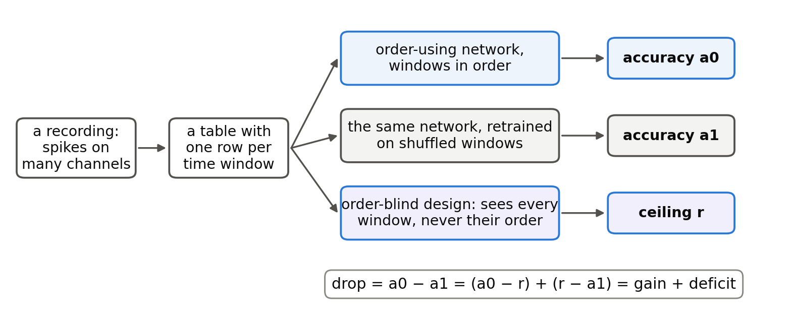
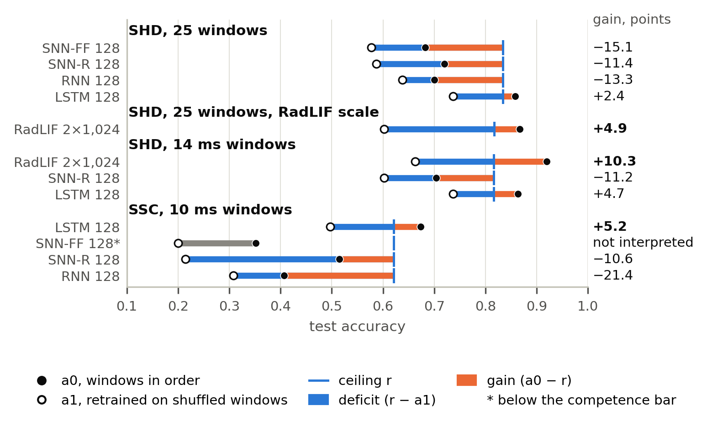
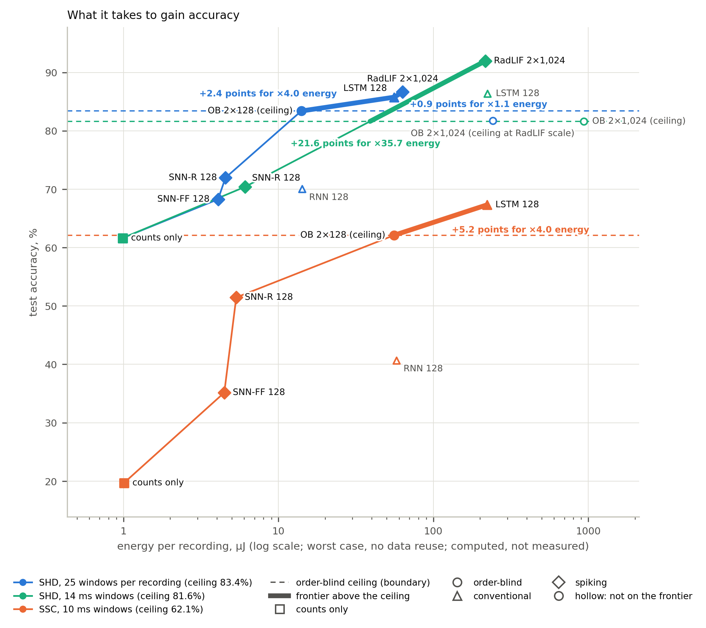

# Energy-Accuracy Tradeoff Benchmarking on Spatio-Temporal Datasets

**To what extent do networks use the order of events, and what does the extra accuracy cost in energy?**

An independent research project that extends my UCLA COSMOS 2026 project on the energy efficiency of
spiking neural networks
([UCLA-COSMOS-SNN-Energy-efficiency](https://github.com/Avi-Seth/UCLA-COSMOS-SNN-Energy-efficiency)).

**Status (24 Nov 2026):** Training finished. Every run repeated on 22 Nov 2026 w/ notebooks in this repository, and every run gave similar test accuracy and same answer. I have not finished the analysis.

## Credits Section:

- **My work:** I read the research papers, framed the question (To what extent networks use the order of
  events, and what the extra accuracy costs), designed the experiment (order-blind ceiling,
  shuffled-window test, and drop = gain + deficit modeling), chose the network architectures and energy cases, and I am currently analyzing the results.
  I also included Deep-Set-inspired designs as order blind networks for the order-blind ceiling.   
- **AI assistance:** Claude Opus (Anthropic) wrote most of the code to my specifications: dataset
  loading and checks, the model implementations, the energy accounting, and figures/charts. It also 
  helped draft the explanations in the notebooks, and this README which I edited.
- **Help from Others:** Discussed the project idea with my School CS teacher, and my father helped manage the training (due to school commitments).
- **Other code:** the RadLIF model is adapted from SpArch (Idiap Research Institute, BSD-3-Clause), as
  credited below.
- **Checking:** Every notebook has been run, and results have been checked against the outputs that are saved within the code files. I take responsibility for the code and the conclusions. On 22 Nov 2026, all 428 runs were repeated with the
  published notebooks with an NVIDIA L4 GPU (PyTorch 2.14.1 on Google Colab).

### Decisions made after the results were known

1. **Ten order-blind designs dropped.** The first full runs on SHD also trained ten more
   order-blind designs (5 seeds at each of the two SHD settings, 100 runs). I dropped them to keep the
   study smaller and to use the same set of designs on SHD and SSC; finding the highest possible
   ceiling was not the aim. Their runs are published in `dropped_order_blind_designs.zip`.
   These designs were never trained on SSC. However, dropping of these designs does not materially change the analysis 
   and conclusions being drawn. Adding them back moves the 25-window ceiling from 83.4% to 84.2% and the LSTM's gain
   from +2.4 to +1.6 points.
2. **Energy accounting** was revised after the runs in early November 2026, to follow Dampfhoffer et al.
   more closely: in the worst case the first layer of a conventional network now pays for every input
   cell, and the two best cases now charge every register access and memory access that their
   equations list. Energy is computed in `04_analyze_results`, from counts that the runs saved, so the
   revision changed no accuracy, no gain and no verdict. The earlier accounting is in this
   repository's history.
3. **The LSTM verdict on SHD at 25 windows depends on which designs compete for the ceiling.** Against
   the ceiling of the seven designs of its size its gain (+2.4 points) does not pass the decision
   rule; against the ceiling of all eight designs (+4.0 points) it does. Both are reported (Table S1).
4. **Earlier exploratory runs shaped the study.** Before the final runs, exploratory runs between 
   August and October 2026 were used to choose the designs and settings.

## Methodology

Spiking networks are often said to use the timing of events. These Colab notebooks test whether
networks trained on two spoken-word datasets, SHD and SSC, actually use the order of time windows, and
what each model would cost in energy.

Every recording is cut into time windows of spike counts (one row per window, one column per input
channel). Three kinds of model read these tables:

- a **count classifier** sees only each channel's total over the recording;
- **order-blind designs** see every window but never their order: they apply the same small network to
  every window and combine the windows by their sum or mean (the Deep Sets form) or by their maximum
  (as in PointNet). The best of them on held-out recordings is the order-blind ceiling *r*;
- **order-using networks** (spiking networks, a recurrent network, LSTMs and RadLIF) are trained twice
  from the same seed: windows in order (test accuracy *a0*) and windows shuffled (*a1*).

```
drop = a0 - a1 = (a0 - r) + (r - a1) = gain + deficit
```



*Figure 1 of `04_analyze_results`: the three measurements behind every verdict.*

A network can only be said to need the order by at most its gain over the order-blind ceiling. A
difference counts only if its mean over seeds is more than twice its standard deviation. Energy per
recording is computed (not measured) with a hardware-aware accounting, in three cases from no data
reuse to weights kept on the chip.

## Results



*Figure 2 of `04_analyze_results`: every network's loss from shuffling, split at its order-blind
ceiling. Filled circle: accuracy with the windows in order (a0); open circle: retrained on shuffled
windows (a1); vertical line: the ceiling r; orange: gain; blue: deficit. Bold gains pass the decision
rule.*

- **Scrambling lowered every network's accuracy**, but a model that never sees the order did as well
  as or better than most networks. The small spiking networks (128 neurons) scored below it in every
  setting: 68.3 to 72.0% on SHD at 25 windows against a ceiling of 83.4% (70.4% at 14 ms against
  81.6%), and 51.5% or less on SSC against 62.1%.
- **Only three cases clearly beat the order-blind ceiling:** RadLIF on SHD (+4.9 points at 25 windows,
  +10.3 at 14 ms) and the LSTM on SSC (+5.2). The LSTM on SHD did not pass the decision rule
  (+2.4 points at 25 windows, +4.7 at 14 ms), except against the larger set of designs at 25 windows
  (see decision 3 above).
- **A large drop is not a large need for order.** Scrambling cost SNN-R 128 on SSC 30.0 points, yet
  with the order intact it was still 10.6 points below the ceiling.
- **Accuracy above the ceiling cost energy.** The LSTM used about 4 times the energy of the
  order-blind ceiling, in all three energy cases, for +2.4 points on SHD (25 windows) and +5.2 points
  on SSC. On SHD at 14 ms the cheapest model above the ceiling, RadLIF 2x1,024, used 35.7 times the
  energy of SNN-R 128 for +21.6 points (worst case).

  

  *Figure 4 of `04_analyze_results`: test accuracy against energy per recording (worst case, no data
  reuse; computed, not measured). Each line is a frontier; dashed lines are the order-blind ceilings.*

- **RadLIF was cheaper than the order-blind design of its size** at 25 windows in all three energy
  cases, and at 14 ms in two of the three.
- **Most of the SHD test set comes from speakers never heard in training** (1,840 of 2,264
  recordings). The verdicts on those recordings alone are the same as on the whole test set.

## Limitations

- Each ceiling is the best of seven or eight order-blind designs, chosen on held-out recordings. A
  better design could shrink the gains. At RadLIF's scale, the design chosen on held-out recordings
  (81.7% on test) scored below the smaller OB 2x128 (83.4% on test).
- Energy is computed from counts of operations and memory accesses on an imagined 8-bit chip, not
  measured on hardware. Only comparisons within one energy case are meaningful.
- 5 seeds on SHD and 3 on SSC.
- On the negative control, the LSTM's accuracy rose 1.0 ± 0.3 points
  when its windows were shuffled again. The cause is not known.
- The two published models were reproduced below their authors' figures: the SSC authors' LSTM set-up
  scored 67.3% (the authors report 75.0% with the same training loss), and RadLIF here
  differs from the published RadLIF in its time-constant range, in leaving out one factor of its
  adaptation update, in its surrogate-gradient slope and in its depth (2 layers here). Its 92.0% on
  SHD at 14 ms is below the 94.62% of the published 3-layer network.
- The verdicts hold at the window widths tested; "at this width" is part of every verdict.
- Shuffle-and-retrain tests and order-free baselines have been used before in other fields and on
  these datasets in related forms. I make no claim that this study is the first of its kind.

## Run it in Colab

| notebook | what it does | GPU | what Run all does as the notebook is set |
|---|---|---|---|
| [](https://colab.research.google.com/github/Avi-Seth/Energy-Accuracy-Tradeoff-Benchmarking-on-Spatio-Temporal-Datasets/blob/main/01_explore_datasets.ipynb) `01_explore_datasets` | Opens SHD and SSC (and, if switched on, DVS128 Gesture), prints and draws recordings, cuts them into time windows exactly as the training notebooks do, and shows what the experiments do to the windows (shuffling, reversing, joining). | no | downloads SHD and SSC and draws everything |
| [](https://colab.research.google.com/github/Avi-Seth/Energy-Accuracy-Tradeoff-Benchmarking-on-Spatio-Temporal-Datasets/blob/main/02_train_SHD.ipynb) `02_train_SHD` | SHD: defines every model, with why it is used and its architecture; runs self-checks; trains every model; saves every run's accuracy, its answers on the test recordings and the counts that the energy estimate needs. | yes | a quick test of the whole notebook |
| [](https://colab.research.google.com/github/Avi-Seth/Energy-Accuracy-Tradeoff-Benchmarking-on-Spatio-Temporal-Datasets/blob/main/03_train_SSC.ipynb) `03_train_SSC` | The same for SSC. | yes | a quick test of the whole notebook |
| [](https://colab.research.google.com/github/Avi-Seth/Energy-Accuracy-Tradeoff-Benchmarking-on-Spatio-Temporal-Datasets/blob/main/04_analyze_results.ipynb) `04_analyze_results` | Computes every model's energy per recording, chooses the ceilings on held-out recordings, computes drop, gain and deficit with the decision rule, and makes every table (CSV and Markdown) and figure (PNG and PDF). | no | every table and figure of the study, from `results.zip`, in about a minute |

1. Click a badge. The notebook opens in Colab.
2. For `02` and `03`, choose a GPU: Runtime > Change runtime type.
3. Runtime > Run all.

A full run saves its results on Google Drive, so Colab asks
once for permission.

**The data.** SHD and SSC are downloaded from the dataset authors' site, https://zenkelab.org/datasets/
(SHD 169 MB; SSC 1.7 GB for all three of its files, 1.5 GB for the two that `03` uses). Every download
is checked against the checksum the site publishes, then unpacked on the Colab machine. If you already
have the files, for example on your Google Drive, set `MY_DATA_DIR` in Step 1 of the notebook to their
folder and nothing is downloaded. DVS128 Gesture, used only in `01`, is off by default; `RUN_DVS = True`
downloads it with the tonic library.

**Where the outputs go.** A Colab machine and everything on it is deleted when the session ends. So by
default each notebook's last cell packs its outputs into one `.zip` file and offers it as a download.
With `USE_DRIVE = True` (Step 1) the outputs are saved on your Google Drive instead, in the folder
`shd_ssc_order/`; Colab asks once for permission.

## The full study

`02` and `03` run a test: some recordings and one or two training epochs. Numbers are insignificant, but every cell runs. For the full study, set `QUICK = False` in Step 1. The
notebook then saves every run on your Google Drive the moment it ends. A full run can last longer than
a Colab session; if the session stops, open the notebook again and choose Run all: runs already saved
are skipped. For `03` also choose High-RAM (Runtime > Change runtime type): its 75,466 training
recordings take about 5 GB of memory.

Measured GPU hours on an NVIDIA L4. Before training, every notebook times each model on the GPU you have
and prints its own estimate; a progress bar then shows the time left.

| notebook | experiment | what | runs | full run (Early Nov 2026) | repeat run (22 Nov 2026) |
|---|---|---|---|---|---|
| `02_train_SHD` | `shd_controls` | control tasks with known answers (chains, reversal, negative control) | 150 | 1.59 | 0.85 |
| `02_train_SHD` | `shd_25` | SHD, 25 windows per recording, five seeds | 125 | 1.14 | 1.14 |
| `02_train_SHD` | `shd_14ms` | SHD, 100 windows of 14 ms, five seeds | 105 | 4.21 | 4.23 |
| `03_train_SSC` | `ssc_10ms` | SSC, 100 windows of 10 ms, three seeds | 48 | 12.40 | 13.80 |

`02` and `03` do not depend on each other: run them one after the other or, if your Colab account allows
two GPU sessions at once, at the same time.

## The analysis

`04_analyze_results` needs no GPU. As it is set (`RESULTS = 'published'`), it downloads `results.zip`
from this repository: the saved runs of the study (428 runs, one small file each, with every model's
accuracy, its answer on every test recording and the counts that the energy estimate needs). It then
computes the energy of every model and remakes every table and figure. To analyse your own full runs
instead, set `RESULTS = 'mine'`: the notebook reads them from `MY_RESULTS_DIR` on your Google Drive, and
skips whatever has not been run yet.

## Files

| file | what it is |
|---|---|
| `01_explore_datasets.ipynb` to `04_analyze_results.ipynb` | the four notebooks |
| `results.zip` | the saved runs of the study: `results/shd_controls`, `results/shd_25`, `results/shd_14ms` and `results/ssc_10ms`, each with a `meta.json` (the experiment's description) and a `runs/` folder (one `.json` file per run) |
| `dropped_order_blind_designs.zip` | the 100 runs of the ten order-blind designs that were dropped (see "Decisions made after the results were known") |
| `figures/` | Figures 1, 2 and 4 of `04_analyze_results`, as made by the 22 Nov 2026 run (every figure of the study is also in the analysis output of 04) |
| `Network_Architectures_and_Energy_Calculations.md` | every model's architecture and how its energy is computed |
| `REFERENCES.md` | every source the notebooks rely on |
| `requirements.txt` | the Python packages, for running outside Colab |

## Running outside Colab

The notebooks are written for Colab. To run one in Jupyter on your own computer, install the packages
of `requirements.txt` and change the folders of Step 2 (`DATA_DIR`, and `BASE_DIR` or `OUT_DIR`), which
point to Colab's `/content/` folder. Google Drive is not needed when `USE_DRIVE = False`.

## Data, code and credits

- **SHD and SSC:** B. Cramer, Y. Stradmann, J. Schemmel and F. Zenke, The Heidelberg Spiking Data Sets
  for the Systematic Evaluation of Spiking Neural Networks, IEEE Transactions on Neural Networks and
  Learning Systems 33(7), 2744-2757 (2022), doi:10.1109/TNNLS.2020.3044364. The datasets are licensed
  under Creative Commons Attribution 4.0 International (https://creativecommons.org/licenses/by/4.0/)
  and are downloaded from https://zenkelab.org/datasets/; they are not part of this repository.
- **DVS128 Gesture** (exploration notebook only, off by default): A. Amir et al., A Low Power, Fully
  Event-Based Gesture Recognition System, 2017 IEEE Conference on Computer Vision and Pattern
  Recognition (CVPR), 7388-7397, doi:10.1109/CVPR.2017.781; downloaded with the tonic library
  (https://tonic.readthedocs.io/en/latest/generated/tonic.datasets.DVSGesture.html).
- **RadLIF:** A. Bittar and P. N. Garner, A surrogate gradient spiking baseline for speech command
  recognition, Frontiers in Neuroscience 16, 865897 (2022), doi:10.3389/fnins.2022.865897. The RadLIF
  code in `02_train_SHD.ipynb` is adapted from SpArch (https://github.com/idiap/sparch), Copyright 2022
  Idiap Research Institute, BSD-3-Clause; its notice is kept in the notebook.
- **Leaky and recurrent leaky neurons as in snnTorch:** J. K. Eshraghian et al., Training Spiking
  Neural Networks Using Lessons From Deep Learning, Proceedings of the IEEE 111(9), 1016-1054 (2023),
  doi:10.1109/JPROC.2023.3308088. The training notebooks check that their neurons give the same
  outputs and gradients as snnTorch 1.0.0's.
- **Energy accounting:** M. Dampfhoffer, T. Mesquida, A. Valentian and L. Anghel, Are SNNs Really More
  Energy-Efficient Than ANNs? An In-Depth Hardware-Aware Study, IEEE Transactions on Emerging Topics in
  Computational Intelligence 7(3), 731-741 (2023), doi:10.1109/TETCI.2022.3214509; costs per operation
  from M. Horowitz, Computing's energy problem (and what we can do about it), 2014 IEEE International
  Solid-State Circuits Conference (ISSCC), Digest of Technical Papers, 10-14,
  doi:10.1109/ISSCC.2014.6757323.
- **Order-blind designs:** M. Zaheer, S. Kottur, S. Ravanbakhsh, B. Poczos, R. Salakhutdinov and
  A. Smola, Deep Sets, Advances in Neural Information Processing Systems 30 (NIPS 2017),
  arXiv:1703.06114 (a function that does not depend on the order of its inputs, when they come from a
  countable set such as whole-number spike counts, can be written as
  $`\rho\left(\sum_t \phi(x_t)\right)`$); C. R. Qi, H. Su, K. Mo and L. J. Guibas, PointNet: Deep Learning on
  Point Sets for 3D Classification and Segmentation, 2017 IEEE Conference on Computer Vision and
  Pattern Recognition (CVPR), 77-85, doi:10.1109/CVPR.2017.16 (combining the elements by their
  maximum).

The full list of 15 references is in `REFERENCES.md`.
